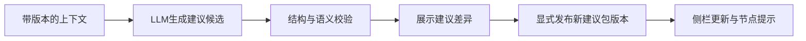

# LLM建议读写协议（设计与静态样例）

本轮没有调用LLM，没有建议写回，没有实现任何服务端接口。examples/下的JSON用于展示未来交付契约，candidate状态不代表已生成或已发布的实际建议。

## 1. LLM读取什么

LLM输入是llm_context，不是整份学生数据库，也不是没有对象上下文的节点数组。

它包含：当前学生的技术ID、角色、图谱与快照版本、档案版本、资源版本、学习目标/可用时间/偏好、当前评价场景、相关节点与边、对应评价结果、评价证据、可用资源和现有建议。

本次分别生成教师和学生两个输入样例：

- examples/llm-context-teacher.json
- examples/llm-context-student.json

两者引用DEMO001的mixed_evidence同一份快照，但audience和当前建议不同。没有导出姓名、学号或本机截图路径；student_id足以在响应中对应对象。背景资料必须注明来源，未知就保留未知，不从分数推断个人特质。

task.target_node_ids规定允许更新的节点，本次为C05；include_overview规定能否更新target_node_id=null的总体建议，教师示例为false，学生示例为true。使用现有ID，输出record_type=recommendation_update。学习目标、教师观察、教材或资源正文均视为背景数据，不能作为改变输出协议或覆盖评价事实的指令。

## 2. LLM交付什么

只交付建议变更候选：

```text
context_id + subject + audience
+ graph_ref + basis_snapshot + profile_version
+ resource_catalog_version
+ base_bundle_id + base_bundle_version
+ proposed_bundle_version
+ operations[]
```

operations支持：

- upsert：提交完整建议对象，必须携带recommendation_id。已有ID只更新原对象、原角色和原target_node_id，不挪作其他用途。
- remove：移除指定建议ID，只允许处理当前角色已有建议。移除不影响节点、关系或成绩。

示例文件examples/recommendation-update-candidate.json将教师C05建议作为候选更新，base_bundle_version=1，proposed_bundle_version=2。generated_by.kind=example且model=null，明确不是LLM真实运行结果。

examples/recommendation-update-overview-candidate.json另示范学生总体建议更新，target_node_id=null，与学生输入中的include_overview=true相对应。这两个候选是基于同一建议包v1的独立示例，不应连续直接应用：任意一个发布为v2后，另一个需重新基于v2生成或重定基线。

schema禁止加入node_results、scores、nodes、edges等额外字段，LLM不能借“更新建议”改分数或支撑权重。未来公共图谱编辑应使用另一套结构变更契约，并单独升级graph_version。

## 3. 如何更新到图谱和侧栏

建议存储在recommendation_bundle，图谱只通过target_node_id关联：



“更新到图谱”指更新节点关联的建议、提示徽标或复习路径；公共节点不需要复制学生文案。当前角色读取自己的active建议。上一个建议包版本保留，不能覆盖已发布历史。

本次只制作候选样例及离线验证器，没有实现上述发布管道。未来接入时需把版本检查与写入作为同一原子操作：在当前版本仍等于base_bundle_version时一次性应用全部操作，失败时不产生半更新。

## 4. 必须校验的关联与边界

| 检查 | 不通过时的行为 |
|---|---|
| subject与当前学生一致 | 拒绝，不能写到其他学生 |
| context_id与当前任务节点范围一致 | 拒绝超出本次要求的节点更新 |
| audience与目标建议角色一致 | 拒绝，不能用教师更新覆盖学生建议 |
| graph_ref与当前图谱一致 | 拒绝过期或不同结构的建议 |
| basis_snapshot ID/revision一致 | 拒绝基于旧成绩的覆盖 |
| profile_version一致 | 拒绝基于旧学习背景的覆盖 |
| base_bundle_id/version一致 | 拒绝覆盖更晚建议 |
| proposed_bundle_version=base+1 | 拒绝不连续或回退版本 |
| resource_catalog_version一致 | 拒绝引用过期资源目录 |
| node/evidence/resource引用有效 | 拒绝虚构节点、外来学生证据或不可用资源 |
| 更新字段限于建议 | 拒绝改分、改学习进度或改公共结构 |
| 输出仍为candidate | 不允许模型自己将建议发布为active |

规则校验只能检查格式、引用和部分依据约束，不能证明建议的教学质量。发布前应能查看原建议、候选建议和所依据的测评记录。

## 5. 本次验证范围

离线工具验证两个正例候选，并验证14种反例会被拒绝：错学生、未知上下文、旧快照、旧建议版本、旧档案、旧资源目录、覆盖成绩、未知节点、外来证据、未知资源、跨角色更新、不存在的删除对象、模型直接标记active、更新超出本次任务范围。

这属于协议检查，不是已实现的后端权限、身份认证、LLM调用或数据库事务。正式登录和真实权限仍不在当前演示范围。
