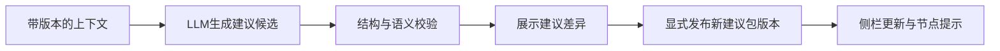

# LLM建议读写协议（设计与静态样例）

本轮没有调用LLM，没有建议写回，没有实现任何服务端接口。examples/下的JSON用于展示未来交付契约，candidate状态不代表已生成或已发布的实际建议。

## 1. LLM读取什么

LLM输入是llm_context，不是整份学生数据库，也不是没有对象上下文的节点数组。

它包含：当前学生的技术ID、角色、图谱与快照版本、档案版本、资源版本、学习目标/可用时间/偏好、当前评价场景、相关节点与边、对应评价结果、评价证据、可用资源和现有建议。

本次按任务生成三份输入样例：

- examples/llm-context-teacher.json：教师诊断C05，一阶子图，11节点/17边/3条测评证据。
- examples/llm-context-student-C05.json：学生复习C05，同一个11节点局部子图。
- examples/llm-context-student.json：学生总体画像，12项能力摘要与少量重点项，共20节点/17边/4条直接测评证据。

三者引用DEMO001的mixed_evidence同一份快照，但audience、任务范围和当前建议不同。没有导出姓名、学号或本机截图路径；student_id足以在响应中对应对象。背景资料必须注明来源，未知就保留未知，不从分数推断个人特质。

task.target_node_ids规定允许更新的节点，两个局部示例为[C05]、include_overview=false；总体示例target_node_ids=[]、include_overview=true，只更新target_node_id=null的总体建议。输出record_type=recommendation_update。学习目标、教师观察、教材或资源正文均视为背景数据，不能作为改变输出协议或覆盖评价事实的指令。

selection.mode明确区分node_neighborhood与overview_summary。局部模式只沿实际边取一阶，不扩张邻居的全部证据闭包。当前C05的直接先修是C02模拟电子技术，不是C04信号与系统；模型不能补造先修关系。总体画像不能只看一个课程邻域，应读取所有能力的分数/覆盖摘要及少量重点证据。

selected_results保留原status，但证据只提供本子图可见部分，detail_scope与omitted_*明确标注解释范围。能力分数可作为预制事实摘要，不能据此推断未提供的知识点评价。若资料不足，只能建议补测/请求更多上下文，不生成未经依据的弱项结论。

## 2. LLM交付什么

只交付建议变更候选：

```text
context_id + subject + audience
+ graph_ref + basis_snapshot + profile_version
+ resource_catalog_version
+ base_bundle_id + base_bundle_version
+ proposed_bundle_version
+ operations[]
```

operations支持：

- upsert：提交完整建议对象，必须携带recommendation_id。已有ID只更新原对象、原角色和原target_node_id，不挪作其他用途。
- remove：移除指定建议ID，只允许处理当前角色已有建议。移除不影响节点、关系或成绩。

示例文件examples/recommendation-update-candidate.json将教师C05建议作为候选更新，base_bundle_version=1，proposed_bundle_version=2。generated_by.kind=example且model=null，明确不是LLM真实运行结果。

examples/recommendation-update-overview-candidate.json另示范学生总体建议更新，target_node_id=null，与学生输入中的include_overview=true相对应。这两个候选是基于同一建议包v1的独立示例，不应连续直接应用：任意一个发布为v2后，另一个需重新基于v2生成或重定基线。

schema禁止加入node_results、scores、nodes、edges等额外字段，LLM不能借“更新建议”改分数或支撑权重。未来公共图谱编辑应使用另一套结构变更契约，并单独升级graph_version。

## 3. 如何更新到图谱和侧栏

建议存储在recommendation_bundle，图谱只通过target_node_id关联：



“更新到图谱”指更新节点关联的建议、提示徽标或复习路径；公共节点不需要复制学生文案。当前角色读取自己的active建议。上一个建议包版本保留，不能覆盖已发布历史。

本次只制作候选样例及离线验证器，没有实现上述发布管道。未来接入时需把版本检查与写入作为同一原子操作：在当前版本仍等于base_bundle_version时一次性应用全部操作，失败时不产生半更新。

### 候选Diff预览与教师采纳（后续阶段）

教师请求生成建议后，在侧栏按recommendation_id展示原active与新candidate，比较摘要、行动、依据节点、证据和资源，明确新增/修改/删除。桌面可左右比较，窄屏上下排列。依赖版本与依据放在可展开区域，不把协议字段全部铺在主页面。

candidate独立保存或保存在独立内存草稿中，不修改active包或其缓存，不影响学生看到的内容。候选中所有文案按普通文本渲染，不能作为HTML或脚本执行。预览可突出“建议复习”的节点，但不得改变客观分数、health_color、阶段低分stroke_style或物理坐标。

教师点击“确认采纳”后发出发布命令；未来后端再次检查图谱、快照、档案、资源和建议包版本，再原子应用全部操作、保存新bundle版本并记录update_id、操作者、时间、受影响建议ID和依据版本。发布的副本变为active/llm_generated，原candidate及旧active版本保留。若版本过期则提示重新生成，不自动覆盖新建议；取消或发布失败时active不变。update_id作为幂等键，重复点击不能产生重复发布。

audience表示建议面向谁，不表示审核者身份。教师可以审核面向学生的建议；学生只能读取已发布结果。正式权限由后续服务端控制，不能把当前模拟角色选择当作真实审核权限。

默认整包操作一起采纳或取消。若以后支持逐条采纳，应基于选中操作重新生成并校验发布候选，不能在客户端删掉原操作后复用原update_id。回退也应生成新版本恢复旧内容，不改写已发布历史。

## 4. 必须校验的关联与边界

| 检查 | 不通过时的行为 |
|---|---|
| subject与当前学生一致 | 拒绝，不能写到其他学生 |
| context_id与当前任务节点范围一致 | 拒绝超出本次要求的节点更新 |
| audience与目标建议角色一致 | 拒绝，不能用教师更新覆盖学生建议 |
| graph_ref与当前图谱一致 | 拒绝过期或不同结构的建议 |
| basis_snapshot ID/revision一致 | 拒绝基于旧成绩的覆盖 |
| profile_version一致 | 拒绝基于旧学习背景的覆盖 |
| base_bundle_id/version一致 | 拒绝覆盖更晚建议 |
| proposed_bundle_version=base+1 | 拒绝不连续或回退版本 |
| resource_catalog_version一致 | 拒绝引用过期资源目录 |
| node/evidence/resource引用有效 | 拒绝虚构节点、外来学生证据或不可用资源 |
| 引用实际存在于本次上下文 | 即使全图/数据库中存在，也不能凭空引用未提供的节点、证据或资源 |
| 更新字段限于建议 | 拒绝改分、改学习进度或改公共结构 |
| 输出仍为candidate | 不允许模型自己将建议发布为active |

规则校验只能检查格式、引用和部分依据约束，不能证明建议的教学质量。发布前应能查看原建议、候选建议和所依据的测评记录。

## 5. 本次验证范围

离线工具验证两个正例候选，并验证17种反例会被拒绝：原14种错对象/版本/字段/任务范围错误，以及引用全图存在但本次未提供的节点、同一学生证据或资源三类错误。

这属于协议检查，不是已实现的后端权限、身份认证、LLM调用或数据库事务。正式登录和真实权限仍不在当前演示范围。

## 6. 结构化输出：提供方与端点适配

采用原生结构化输出，不让模型自由返回文本再用正则提取JSON；优先使用SDK解析结果。单纯JSON模式只能保证JSON语法，不能代替Schema约束。OpenAI Chat Completions与Responses的配置位置不同，且strict支持的Schema是子集。[OpenAI官方文档](https://developers.openai.com/api/docs/guides/structured-outputs)

下面是配置形状示意，不是实际API调用，wireSchema引用本包contracts/recommendation-update.provider.schema.json：

```javascript
// OpenAI Chat Completions，选择支持结构化输出的具体模型/快照
response_format: {
  type: "json_schema",
  json_schema: { name: "recommendation_update", strict: true, schema: wireSchema }
}

// OpenAI Responses
text: {
  format: { type: "json_schema", name: "recommendation_update", strict: true, schema: wireSchema }
}
```

如选择GPT-4o，应核对具体快照能力；本次不替用户选定或调用模型。不能将8类记录的完整业务Schema直接发送：其根oneOf和条件allOf/if/then/not等需要改写。提供方示例采用object根、全部字段required、additionalProperties=false及operations.items内的upsert/remove anyOf分支；完整业务规则仍由contract.schema.json与语义检查执行。

DeepSeek也需按端点区分：其Responses文档列有text.format的json_schema；Chat Completions文档列出的response_format是json_object，不能假设可照搬OpenAI的配置或strict选项。[DeepSeek Responses](https://api-docs.deepseek.com/api/create-response/)、[DeepSeek Chat Completions](https://api-docs.deepseek.com/api/create-chat-completion/)

实际接入前，用所选提供方、具体模型、端点和Schema做最小能力测试。缺少原生Schema约束的端点，可显式采用JSON模式＋完整验证＋有界重试，或改选支持的端点；不得静默退化成正则修复后直接发布。提供方示例仅做离线结构检查，未声明真实API已接受。

处理顺序为“响应完成状态/拒绝/空结果检查 → 原生解析或严格JSON解析 → 完整业务Schema → 对象、版本、作用域与证据校验 → 候选预览”。截断、拒绝、空响应、错误Schema或不合法结果只产生生成失败状态，保留原active建议，不交给图谱渲染。结构化输出不能保证建议的教学正确性，也不能消除网络或拒绝等异常。

## 7. 上下文预算与可解释省略

当前静态样例预算：最多32节点、64边、32条直接测评证据、8项资源及48000个未缩进JSON字符。字符上限是离线包大小约束，不等于token数；接入时须使用具体模型对应的计数方法，为系统提示、输出Schema、资源正文和输出预留实际token预算。

先选择必须的目标及相关事实，再按用途加入有限上下文，不为凑满预算发送全文大纲。超出预算时拆请求或缩减任务范围，不能静默截掉目标知识点或隐藏省略信息。局部与总体请求分开，拥有不同context_id。

任何结果分数均保持原样，只裁剪证据引用，并记录omitted_evidence_count/omitted_input_count；不得因裁剪而重算分数、coverage或health_color。真实成绩缺失与“当前上下文没有展开全部依据”是两种情况，前者用评价字段表达，后者用detail_scope表达。
