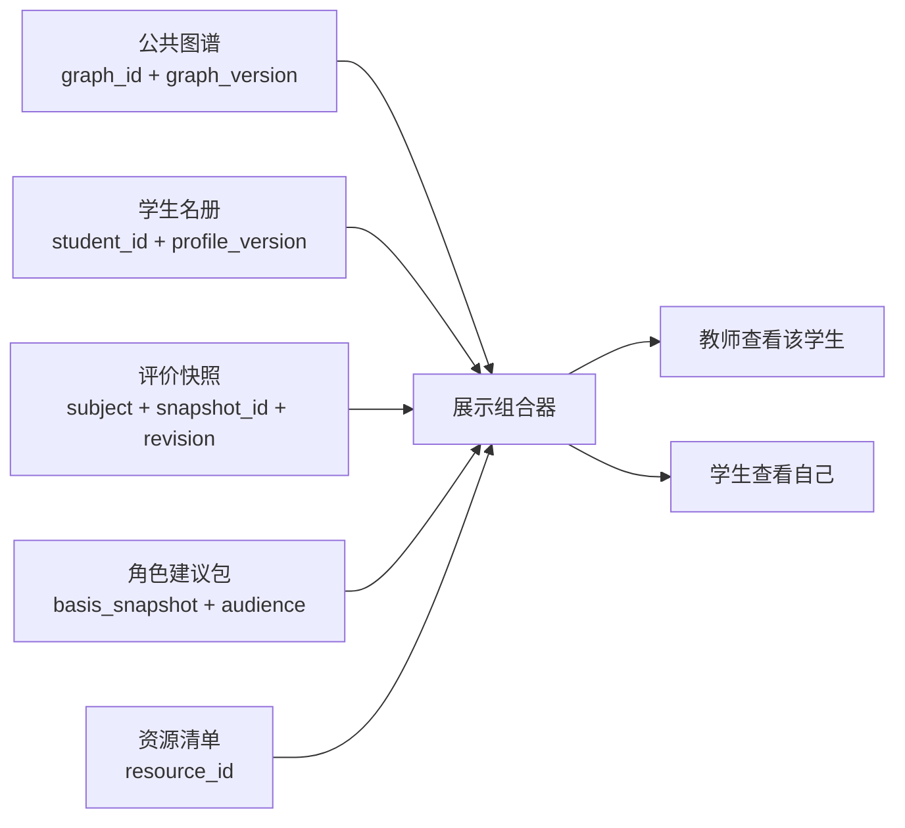

# 专业图谱与个人诊断数据契约 v2.0.0（审查稿）

日期：2026-10-29。本轮只确定契约、制作模拟数据和实施方案，不修改前端、不接入LLM、不执行建议写回。

## 1. 与现有节点契约的联系与不同

现有v1.1.0并非错误，而是把“公共结构”和“某个班级的评价”放在同一份展示快照中。它适合班级总览；有多个学生后，不能继续把学生状态写在唯一公共节点上，否则切换学生会覆盖另一人的评价。

v2拆分保存，但前端组合后仍能沿用当前nodes/edges图谱引擎。

| 关注点 | 现有v1节点展示契约 | v2学生相关契约 |
|---|---|---|
| 回答的问题 | 这是什么节点、如何连接，以及演示班的当前评价 | 谁在何时、哪个评价场景下，学习到哪里、评价结果如何 |
| 身份主键 | node.id，例如C05 | student_id，例如DEMO001 |
| 身份显示 | 课程/能力/知识点名称 | 模拟姓名、模拟学号、班级 |
| 分数位置 | nodes[].status | snapshot.node_results[node_id].status |
| 描述位置 | sidebar_info.description | 公共节点description |
| 建议位置 | 节点中的通用remediation_advice | 与学生/快照/角色绑定的recommendation_bundle |
| 更新范围 | 更换整份班级场景文件 | 图谱、档案、评价、建议可分别更新并保留版本 |
| 能否互相替代 | 节点不是学生 | 学生不是节点；档案也不是成绩表 |

公共图谱、学生名册、评价快照、诊断建议四者通过ID与版本引用连接，不靠姓名或节点名称匹配。



同一学生的评价事实只有一份。教师和学生侧栏采用不同的建议与表达，不维护两套相互冲突的成绩。

## 2. 契约边界与文件

机器校验定义见contracts/contract.schema.json，使用8种record_type。

| record_type | 本次文件 | 内容 |
|---|---|---|
| public_graph | data/graph.json | 唯一的公共节点、边、课程目标、培养方案来源 |
| student_registry | data/students.json | 班级、学生名册、学习背景 |
| evaluation_policy | data/evaluation-policy.json | 制作数据所用阈值和评价口径 |
| evaluation_snapshot | data/snapshots/{student或class}/{id}/{场景}.json | 按对象保存的预制结果及证据 |
| resource_catalog | data/resources.json | 可用的本地复习任务单 |
| recommendation_bundle | data/recommendations/{student_id}/{场景}.json | 教师/学生的总体和逐节点建议 |
| llm_context | examples/llm-context-*.json | 分为节点一阶诊断、总体画像摘要的精简输入 |
| recommendation_update | examples/recommendation-update*-candidate.json | 后续LLM生成的节点或总体建议变更候选样例 |

manifest.json是本次演示包的文件索引，不是新的业务实体或API；标明哪些学生可演示、文件位置及原应用文件哈希。当前schema以闭合字段约束为主，不能向建议变更包任意加入node_results等覆盖字段。

graph_id继续使用现有技术ID `communication-engineering-demo`，class_id继续使用 `COMM-DEMO-40`，以保持既有引用；它们是历史技术标识，不决定界面的专业名称。展示名称仍统一为“电子信息工程（培养方案图谱演示）”。

schema_version区分序列化契约，graph_version区分教学结构版本。此次仅拆分保存，没有改动节点/边，因此v2仍引用graph_version=1。以后改变课程结构、权重或节点ID时必须升级graph_version。

## 3. 公共图谱契约

保留原138节点、285条边及稳定ID，不复制40份公共网络。

- 节点保留id、level、label、display_weight、课程学分/学期、课程目标、课程归属、材料出处等。
- 将sidebar_info.description提升为description。
- 移走status、average_score、assessment_sources、remediation_advice和diagnosis_scope，避免把某人的评价或某角色的建议混入公共结构。
- 三层含义和supports/belongs_to/prerequisite/similar/parallel语义不变。
- 聚合权重仍在边上；相似/并列/先修关系不参与得分计算。
- sources保留文件名与内容哈希；新公共图谱不复制本机用户目录路径。

现有review/data下三个v1文件继续供当前前端使用；v2新文件是待接入数据，不替换应用入口。

## 4. 学生名册与学习背景契约

学生档案示例：

```json
{
  "student_id": "DEMO001",
  "display_name": "陈亦航（模拟）",
  "student_number": "DEMO2024001",
  "class_id": "COMM-DEMO-40",
  "enrollment_year": 2024,
  "profile_version": 1,
  "is_simulated": true,
  "learning_context": {
    "goals": ["巩固电路与信号处理基础，完成阶段性复习。"],
    "available_minutes_per_week": 90,
    "preferred_resource_formats": ["reading", "practice"],
    "teacher_observations": []
  },
  "context_provenance": "simulated_or_unknown"
}
```

- student_id为不可随姓名变化的内部主键；姓名、学号仅供演示选择器辨认身份。
- class_id用于班级成员关系；学生转班或背景信息变化时更新档案版本，历史快照保持原有事实。
- profile_version标记影响建议的背景更新，供LLM避免覆盖基于新背景生成的建议。
- goals、可用时间、资源偏好是有来源的背景，不从得分推测“学习风格”“性格”等。
- 未知信息使用null或空数组。本次只有前三名学生有模拟学习目标和时间偏好，其余不虚填。
- teacher_observations中的每条记录需要observation_id、text、as_of和source；本次未编造教师观察，数组为空。
- 不把密码、会话token、成绩或诊断建议放进学生名册。本次模拟选择不验证身份。

未来真实数据可将is_simulated设为false，context_provenance标明student_supplied、teacher_record、mixed或unknown；当前所有40人均为模拟身份，不包含真实学生资料。

## 5. 评价快照契约

每份快照通过以下信息定位：

```text
subject(type,id)
+ graph_ref(graph_id,graph_version)
+ evaluation_context(scenario_id,period_id,as_of)
+ snapshot_id / revision
```

subject支持class与student。学生与班级使用同一种结果结构，但不同subject，不能把班级分数当作学生默认值。

snapshot_id在某个对象、场景和评价时点上稳定，revision记录该快照数据的修订。新测评时点创建新snapshot_id；修正已有快照时提升revision并保留旧记录，不通过猜测文件名定位最新版。snapshot_id不拼接revision，避免把修订误认为新的测评时点。

图谱版本、名册版本和评价策略版本均明确引用。比较班级和个人时，必须匹配graph_ref、scenario_id、period_id和评价截止时间，不把全周期回放与第五学期结果直接比较。

node_results以node_id为键，本次每份都提供完整138项。值包含status、progress_source、evidence_refs、input_node_ids。

| 字段 | 说明 |
|---|---|
| achievement_rate | 0–100或null；L3掌握度、L2课程达成、L1能力达成估计 |
| health_color | 已经预制的green/yellow/red/grey，前端直接读取 |
| learning_state | not_started/in_progress/completed，与成绩覆盖独立 |
| learning_progress | 0–1学习进度，未知或不适用时null |
| coverage_rate | 0–1评价证据覆盖，不能替代学习进度 |
| grey_reason | not_started/no_evidence/insufficient_coverage或null |
| score_is_provisional | 存在部分评价但覆盖未完整；与learning_state不等价 |
| evidence_granularity | none/knowledge_assessment/knowledge_aggregate/course_total/course_aggregate |
| aggregation_basis | none/knowledge_assessment/weighted_inputs/course_total |
| sample_count / expected_count | 有效评价人数/评价对象人数；个人为0或1/1，班级为0或40/40，不是达标人数 |
| score_provenance | 当前为simulated_precomputed，未来可用assessment_precomputed |
| evidence_refs | 当前对象当前快照内的证据ID，不允许跨学生引用 |
| input_node_ids | 参与预制聚合的直接子节点；课程总分入口为空 |
| progress_source | 模拟学习记录/实际学习记录/未知/不适用 |

### 学习进度与覆盖率的例子

mixed_evidence的C05课程：学习进度60%，评价覆盖50%。前三个知识点已学且有分数；第4个知识点学习中但没有测评；第5、6个尚未开始。它们分别对应“已评价”“待评价”“未开始”，不能都视为不及格。

C05如果个人已评价部分低于60分，保留灰色填充并加橙红虚线，表示阶段性低分风险。是否已结课由learning_state决定，不能因coverage_rate=1就认定结课。

能力层learning_progress保持null，避免将课程完成比例冒充能力培养完成度；learning_state只概括支撑课程的培养过程。能力达成高低仍看评价结果，培养过程完成不等于掌握优秀。

本次班级的进度与个人相同，是合成场景的统一教学安排；未来真实班级中学习进度如何统计需另行定义，不能简单复用某个学生的进度。

### 课程总分入口

只有课程总分时，L2可以有分数和coverage_rate=1，L1使用其预制支撑结果；L3保持null/grey。这里覆盖率1表示“该课程总评口径证据完整”，不说明拥有全部知识点证据，必须同时展示evidence_granularity。

同一课程、同一对象、同一评价周期只选择一个聚合入口；课程总分不与知识点汇总重复叠加，也不反推知识点成绩。

### 证据

evidence包含证据ID、node_id、subject、kind、score、sample_count、来源及original_record_ref。当前均为合成测评；历史班级快照标为legacy_class_aggregate，不伪造为逐题原始成绩。

student_knowledge_fixture中的原始分数是全周期模拟数据。阶段快照只暴露该阶段允许使用的记录，未来课程成绩不会因为完整fixture中存在而提前出现在阶段图谱中。

## 6. 诊断与资源契约

建议包绑定subject、graph_ref、basis_snapshot、basis_profile_version和resource_catalog_version，并有独立bundle_id与version。更新建议不会创建新成绩，不改公共节点。

每条建议包含：recommendation_id、audience、target_node_id、kind、priority、summary、basis_node_ids、evidence_refs、actions、review_node_ids、prepare_node_ids、resource_ids、origin和lifecycle。

- target_node_id=null为总体建议，否则关联一个公共节点。
- audience=teacher重帮扶依据、措施和复测；student重可执行复习、先修补习及后继准备。
- 同一角色可以有多条建议；本次数据为每个角色总体1条+每节点1条，便于完整演示。
- 弱项结论必须有当前对象的已评价依据；缺少评价时生成“补充评价/自测”建议，未开始时生成“预习”建议。
- prepare_node_ids仅表示后继学习提醒，不推断后继成绩；similar与parallel不能推断掌握。
- resource_ids引用data/resources.json；本次18份本地任务单确实存在，覆盖18门课程及其知识点。
- 资源path与manifest中的文件路径均以本审查包根目录为基准；未来加载器需拼接包根URL，不能直接当作应用根目录路径或相对于data/的路径。
- 当前建议来源为preset_demo、状态active；LLM示例来源llm_candidate、状态candidate，未发布或写回。

## 7. 给现有渲染器的组合原则

未来实现组合器时：

```text
node.id → snapshot.node_results[node.id]
subject + basis_snapshot + audience + target_node_id → 对应建议
resource_ids → 可用资源
```

公共description用于结构侧栏，当前status用于着色，当前角色的recommendations用于诊断侧栏。教师查看DEMO001与学生查看自己应读同一份个人结果，切换角色只改变建议和表达。

学生个人值标作“个人得分/已评价部分掌握度”，班级值才标作“班级平均”；不要为了兼容旧字段而将个人分数塞进average_score。前端可以新增display_score与score_label，L1统一标作能力达成估计。

缺少快照或节点结果时，应显示“缺少评价数据”；缺少该角色建议时显示“暂无个性化建议”。不回退到班均值，不沿用上一个对象的状态，也不借用其他角色的文案。

### 只读投影与D3布局

DataStore负责加载/缓存和版本核对，将status与当前audience的建议组合成新的ViewNode，不修改graph或snapshot源对象。sidebar_info.recommendations为数组，总体建议target_node_id=null另放overview；相关建议由node_id映射，不只取第一条。

展示投影可增加presentation.fill、presentation.stroke_style和badges，它们只供SVG读取，不能持久化为学生客观结果，也不能由LLM写回。风险判定集中于presentation mapper，描边与选中外环分开。

D3的可变物理坐标由LayoutStore独立保存，不能把只读投影直接交给forceSimulation。保持原算法的同时需要改当前setupLayout/load生命周期：同一图谱对象切换不重新初始化、不自动fit；仅Join本身不能保证坐标稳定。详见建议评估与数据组合器设计.md。

### llm_context的精简投影

llm_context不再复制完整公共节点和完整聚合追溯字段：selected_nodes只包含id/level/label/description；selected_results保留真实status、progress_source及本次提供的证据引用，并明确detail_scope、omitted_evidence_count、omitted_input_count。省略详细证据不改变原快照score/coverage，不意味着数据缺失或得分失效，只限制本次解释深度。

selection记录node_neighborhood或overview_summary模式、种子节点、节点/边/证据/资源/字符预算及上下文局限。focus_summary提供总体请求的少量强弱项。当前C05局部请求保留11个节点；总体请求保留12项能力摘要和少量重点节点，共20个节点。局部请求不能修改总体建议；总体请求不能顺带改写任意节点。

current_recommendations也使用精简摘要，标注省略依据数量；资源的node_ids仅保留与当前选中子图相交部分。模型能引用的ID进一步受本次上下文限制，而不只是存在于整个数据库即可。

contracts/contract.schema.json仍是完整业务校验契约。新增recommendation-update.provider.schema.json仅是面向提供方支持子集的输出示例：展开update根对象、将upsert/remove转成嵌套anyOf、关闭额外字段；不能用它替代业务Schema与语义校验，也未经过真实API接收测试。本次仍为v2.0.0审查草案细化，未更改既有图谱、学生档案或成绩快照格式。

## 8. 已生成的数据与当前应用的关系

40名模拟学生及其三个场景快照全部准备，用于保证班均一致。当前建议齐全的演示身份为DEMO001–DEMO003，后续身份选择器只启用这三人；其余37名已具备评价数据，但尚无个性化建议包，保留为后续扩展。

与当前应用不同，v2是审查数据包，尚未接入任何页面。manifest记录的原前端及旧场景JSON哈希已经核验未变。本轮只运行离线生成与校验工具。
